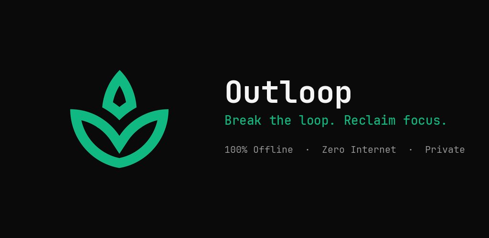

<p align="center">
  
</p>

<h1 align="center">Outloop</h1>

<p align="center">
  <b>Break the loop. Reclaim your focus.</b><br>
  A 100% offline, privacy-first Android digital wellbeing tool that gently ends compulsive short-form video doomscrolling.
</p>

<p align="center">
  <a href="https://github.com/tuncaycelikkanat/NoMoreReels/blob/main/LICENSE"></a>
  <a href="https://developer.android.com/about/versions/oreo"></a>
  
  
</p>

<p align="center">
  <a href="https://github.com/sponsors/tuncaycelikkanat"></a>
  <a href="https://buymeacoffee.com/outloop"></a>
  <a href="https://kreosus.com/outloop"></a>
</p>

---

## 🌟 Overview / Genel Bakış

**Outloop** (formerly *NoMoreReels*) is designed to defeat the modern attention economy's dopamine traps without relying on blunt, frustrating app blockers. 

Instead of locking you out of Instagram entirely, Outloop surgically detects when you land on the infinite **Reels** feed and introduces **mindful friction**—nudging you back to your real life, your feed, or intentional breathing before unconscious doomscrolling takes over.

### 🛡️ The Zero-Internet Guarantee
Unlike many productivity apps that secretly track your habits or phone home to remote servers, **Outloop does NOT even declare the `android.permission.INTERNET` permission in its AndroidManifest.** It is technically incapable of sending a single byte outside your device. Your data never leaves your hands.

---

## ✨ Key Features / Temel Özellikler

- **🧘 Mindful Friction (Bilinçli Sürtünme):** Rather than jarring sudden blocks, Outloop presents a soothing, breathing gateway with mindful quotes and a 5-second reflection delay.
- **📩 DM Single-Reel Tolerance (Akıllı DM Koruması):** Watch videos shared by friends without being trapped! Outloop allows viewing that single reel, but immediately intercepts swipe gestures to prevent falling into the algorithm.
- **⏰ Daily Quotas & Time Tracking (Günlük Kota):** Set daily count and duration limits. Outloop displays early warning nudges when reaching 80% capacity.
- **🌙 Bedtime Mode (Gece Odak Modu):** Automatically enforces strict, zero-tolerance blocking during your designated sleep hours (e.g. 23:30 - 07:00).
- **📊 7x24 Habit Heatmap (Alışkanlık Isı Haritası):** Local, encrypted 168-hour habit matrix revealing your most vulnerable scrolling hours without cloud analytics.
- **🔒 Willpower Lock (İrade Kilidi):** Optional math challenge or PIN lock preventing impulsive disablement during weak moments.
- **🚫 100% Ad-Free & Tracker-Free:** No ads, no analytics, no SDK tracking.

---

## 🏛️ Architecture & Tech Stack

Outloop is built following modern Android Architecture Components and clean engineering practices:

- **UI:** 100% Jetpack Compose with Material 3, Quiet Sage & Ivory zen design system, and full AMOLED dark mode support.
- **Architecture:** Unidirectional Data Flow (UDF) + MVVM with Kotlin Coroutines & `StateFlow`.
- **Observer Engine:** Android `AccessibilityService` (`TYPE_WINDOW_CONTENT_CHANGED`, `TYPE_VIEW_SCROLLED`) with `safeRecycle` memory discipline and non-blocking circuit breakers.
- **Dynamic Rules:** Sourced from decoupled JSON rule configurations (`assets/rules.json`) to adapt to UI changes without native recompilations.
- **Storage:** Local encrypted data structures with atomic backups (`SettingsBackupHelper`).
- **Test Coverage:** Total of **58 robust unit tests** covering the Classifier, Quota calculations, Policy engine, and Gateway specs.

```
app/src/main/java/com/nomorereels/app/
├── action/           # Media control & Overlay UI controllers
├── billing/          # Zero-Internet external support manager (Kreosus, BMC, GitHub)
├── data/             # Local stores (Quota, Heatmap, Settings, Diagnostics)
├── detection/        # Screen classification & Rule evaluation
├── policy/           # Protection levels, navigation tracking & friction specs
├── service/          # AccessibilityService observer & watchdog
└── ui/               # Jetpack Compose screens, widgets & theme
```

---

## 🚀 Building & Testing

### Prerequisites
- Android Studio Ladybug / Meerkat or later
- JDK 17 or JDK 21
- Android SDK 35 (compileSdk 35, minSdk 26)

### Run Unit Tests
```bash
./gradlew testReleaseUnitTest
```

### Build APK (Debug / Release)
```bash
# Build Debug APK
./gradlew assembleDebug

# Build Production Signed APK & AAB
./gradlew assembleRelease
./gradlew bundleRelease
```

---

## ☕ Support the Project

Outloop is free, open source, and independent. If Outloop has helped you reclaim hours of your day, consider supporting its ongoing development:

- 🇹🇷 **Türkiye (TL / Havale & Kart):** [Kreosus (outloop)](https://kreosus.com/outloop)
- 🌍 **Global ($ / Credit Card & Apple Pay):** [Buy Me a Coffee (outloop)](https://buymeacoffee.com/outloop)
- 💻 **Developers & Open Source:** [GitHub Sponsors (@tuncaycelikkanat)](https://github.com/sponsors/tuncaycelikkanat)

---

## 📄 License & Privacy

- **License:** [MIT License](LICENSE)
- **Privacy Policy:** [PRIVACY_POLICY.md](PRIVACY_POLICY.md)
- **Data Safety:** [store_assets/DATA_SAFETY.md](store_assets/DATA_SAFETY.md)
